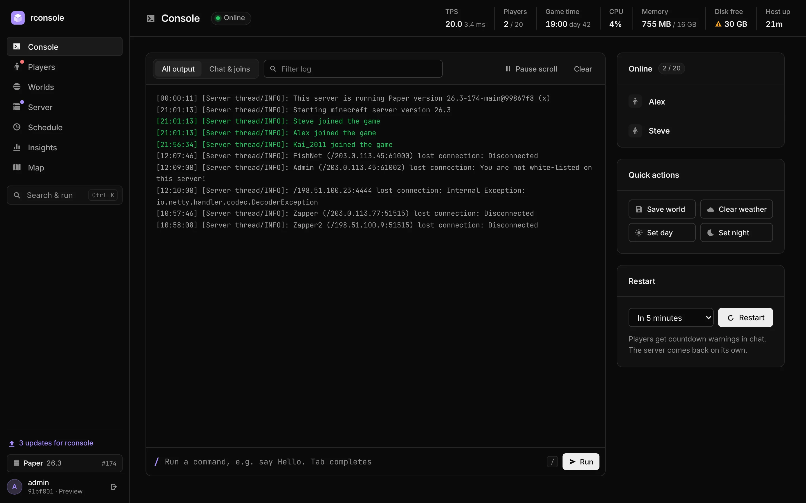
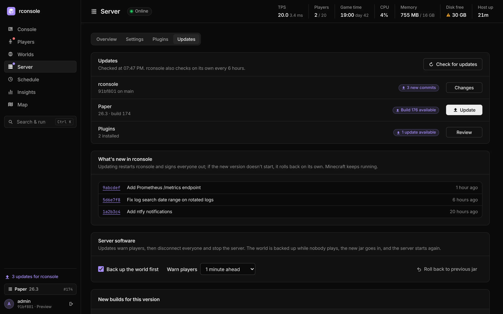
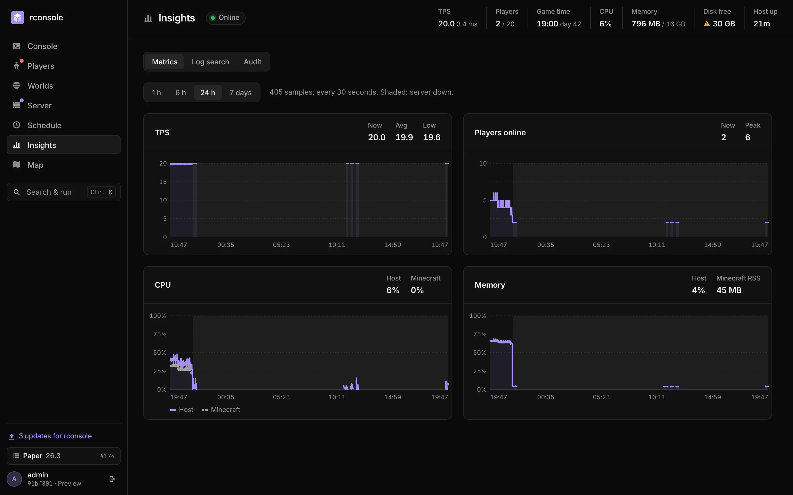
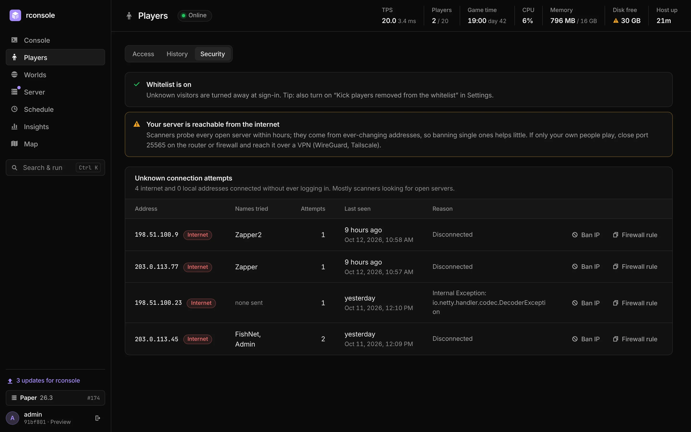
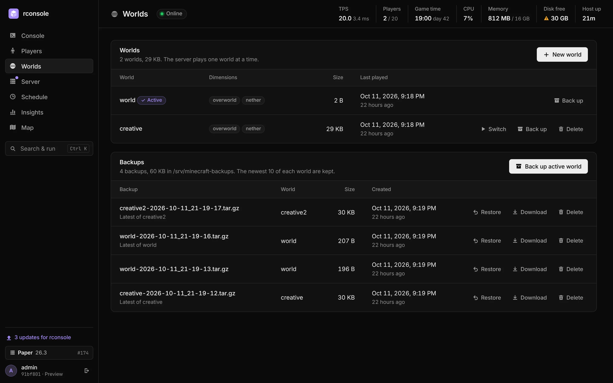
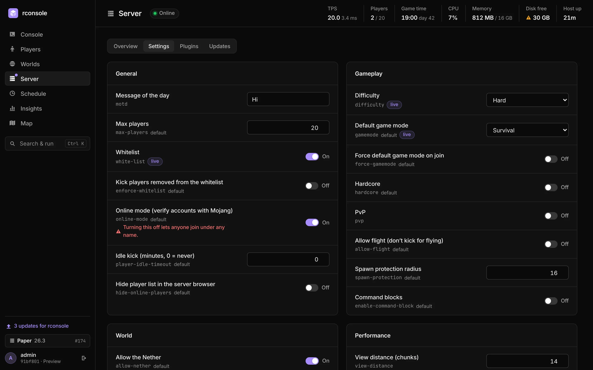
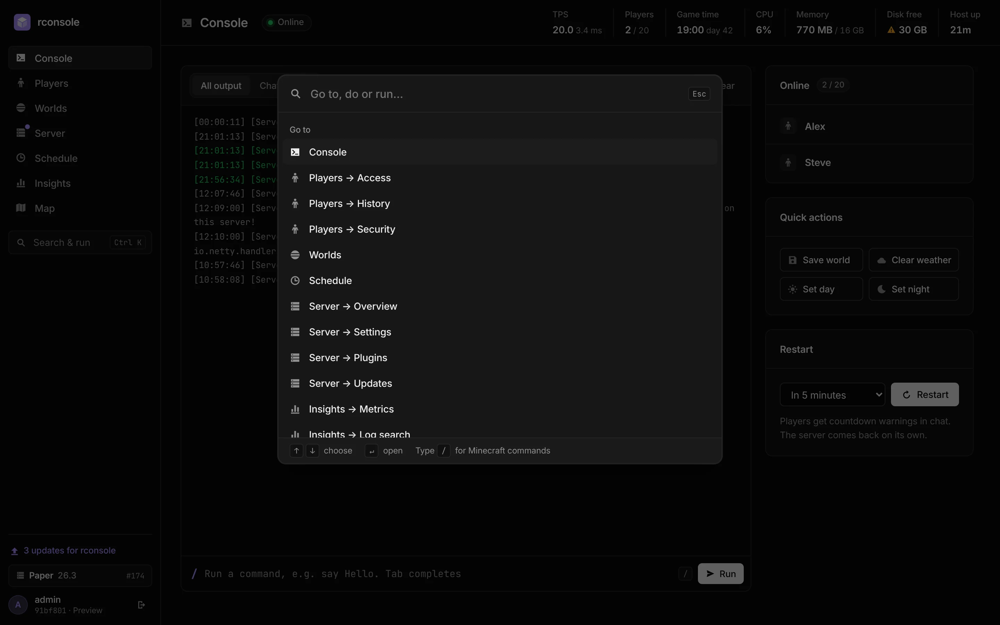
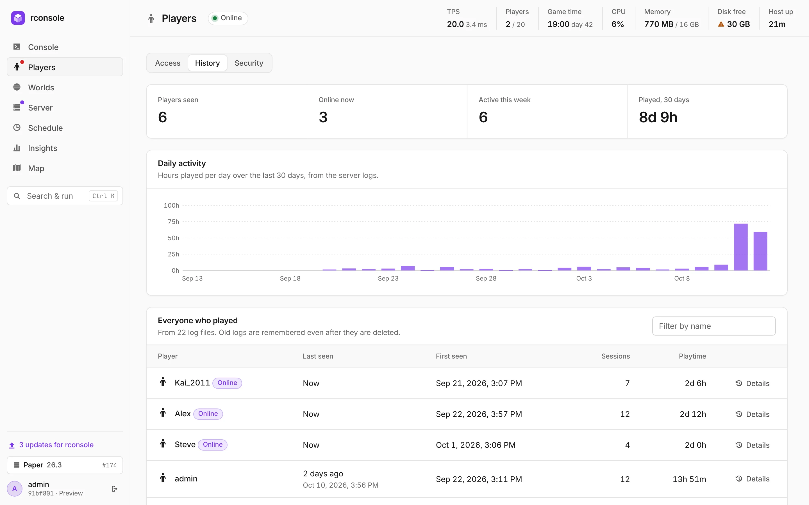
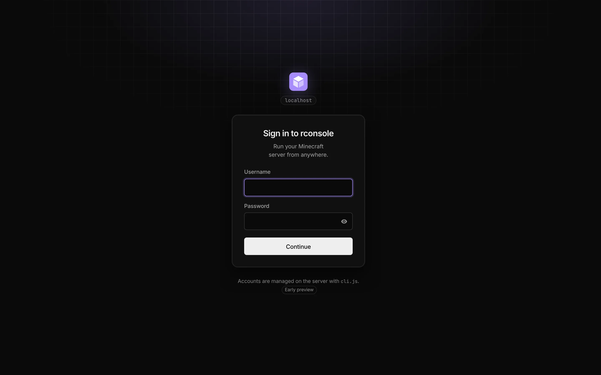
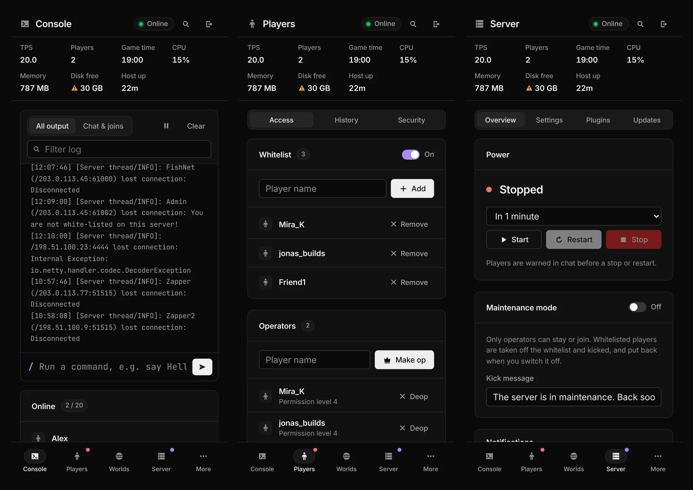

<p align="center">
  
</p>

<h1 align="center">rconsole</h1>

<p align="center">
  <b>A self-hosted web console that installs and runs your Minecraft server.</b><br>
  Pick Vanilla, Paper, Purpur, Folia, Fabric, Quilt, Forge, NeoForge or Velocity; rconsole sets it up with the right Java and gives you a live console, players, worlds, backups, updates, plugins and alerts in one fast, secure page.
</p>

<p align="center">
  <a href="#quick-install"></a>
  <a href="https://github.com/iamozyth/rconsole/actions/workflows/test.yml"></a>
  <a href="https://github.com/iamozyth/rconsole/releases"></a>
  
  
  
  <a href="LICENSE"></a>
</p>

<p align="center">
  <a href="#quick-install">Quick install</a> ·
  <a href="#features">Features</a> ·
  <a href="#screenshots">Screenshots</a> ·
  <a href="#documentation">Documentation</a> ·
  <a href="#faq">FAQ</a>
</p>

<p align="center">
  
</p>

rconsole installs Minecraft servers and runs them as hardened systemd services, then turns RCON and the server's own files into a polished admin panel. It installs in one command, needs nothing but Node.js, and keeps the server's files out of its own reach: everything that changes them runs as the Minecraft user in sandboxed jobs, and every download is checked against its publisher's checksum. It also attaches to a server you already run.

> [!WARNING]
> **Early preview.** rconsole was written largely with an AI coding assistant (Claude Code), with a human steering, reviewing and testing it on a real Paper server. It has automated tests but no independent security review yet. Run it on a trusted network or behind a TLS proxy, keep your own backups, and expect breaking changes.

## Quick install

On a Debian or Ubuntu host:

```sh
curl -fsSL https://raw.githubusercontent.com/iamozyth/rconsole/main/install.sh | sudo bash
```

Then open `http://<your-server>:8080`, sign in, and create your server with **New server** in the server switcher at the top of the sidebar. If a Minecraft server already runs here as a systemd service, the installer offers to attach to it instead. It explains each step before it changes anything; [details below](#what-the-installer-does).

## Features

**Servers, installed for you**
- **Pick the software**: Vanilla, Paper, Purpur, Folia, Fabric, Quilt, Forge, NeoForge or the Velocity proxy, then the Minecraft version and build. rconsole downloads it, runs the mod loader's installer when there is one, and sets up RCON with a random password.
- **The right Java, automatically**: the Eclipse Temurin runtime each Minecraft version needs, side by side, no system Java.
- **Every download verified** against its publisher's checksum, from the publisher's own servers only.
- **Each server in its own sandbox**: a hardened `rconsole-mc@<name>` systemd service with Aikar's flags, a memory size you choose, a console that works even before RCON is up, and autostart after a reboot.
- **Updates and rollback for every distribution**: newer builds and Minecraft versions, the world backed up first, the previous version kept.

**Console and control**
- **Live console**: the server log as it happens, filterable, with a chat-and-joins view and a command prompt with history and **autocomplete** for commands, subcommands, players, game modes and game rules, including plugin commands.
- **Command palette** (Ctrl/⌘ K): jump anywhere, run any action, or type a Minecraft command.
- **Server power**: start, stop and restart with in-game countdowns; **maintenance mode** that lets only operators in and restores the whitelist afterwards.
- **Dashboard**: server state, TPS, players, memory, last backup, problems, updates and disk as tiles, the last six hours as charts, who's online and what changed recently.
- **Server switcher** at the top of the sidebar for every server rconsole runs.

**Players and security**
- **One player list**: everyone the server knows, with whitelist, operator and ban status, filters and a profile panel per player.
- **Web chat**: follow chat, joins and leaves live, talk to everyone as **[Web] you**, whisper to a player, kick from a message.
- **Modpacks** from Modrinth in one step: loader, mods and settings, every file checked.
- **Team roles**: admins, moderators (players, chat and moderation commands) and read-only viewers, globally or per server (a friend can be admin on their own server and see nothing of the others).
- **Single sign-on** with authentik, Keycloak, Auth0 or any OpenID Connect provider; roles from its groups, local accounts as a fallback.
- **Player history** from your logs: sessions, playtime, last IP, daily activity.
- **Player profiles**: position, health, food, level and game mode, equipment, hotbar and inventory live (or as last saved when offline); statistics (play time, deaths, kills, distance, most mined and used) and advancements from the world files; teleport, game mode, heal, kick and clear inventory in one place.
- **File manager** for the whole server folder: edit with syntax checks and a diff before saving, one-click revert, upload (and unpack), download, rename, and delete that archives first.
- **Scanner detection**: spots bots probing your server, explains what to do, and offers a ban or a ready-made firewall rule.

**Worlds and backups**
- Switch worlds, create new ones (seed and type), delete with an automatic archive.
- **Import a world** from your computer: drop a `.zip` (as Finder or Windows make it), `.tar.gz`, `.tar.zst` or `.tar.xz` of a world folder, or of a whole server folder. Resumable uploads of any size; the archive is checked before anything changes, the world it replaces is backed up first. See [Importing a world](#importing-a-world).
- Per-world **backups** with autosave paused during the copy, retention, download, and **restore** over a world or as a new one.
- **Offsite copies** in any S3-compatible bucket (Backblaze B2, Cloudflare R2, AWS S3, Wasabi, MinIO), optionally encrypted before they leave the machine, uploaded after every backup.
- **Automation**: tasks that chain steps (tell players, wait, back up, restart or stop with a countdown, start, run commands, go on only if nobody is online), daily at a time, on a cron schedule, or when something happens: the server started or crashed, nobody has been online for a while, or the log shows a line. Each task belongs to one server.

**Updates and plugins**
- **One check for everything**: rconsole itself, the server software and your plugins or mods.
- **Server updates** for Paper and Folia, SHA-256 verified. Players are warned, then disconnected; the world is backed up while nobody plays; the server starts on the new build. One-click rollback.
- **Plugins and mods from Modrinth**: identify installed jars, update with rollback, enable, disable, search and install, SHA-512 verified.
- **Properties editor** (Server → Properties) for `server.properties` with a review step; live where Minecraft allows it.
- **Settings** for rconsole itself in one place: your account and password, everyone's access and single sign-on, notifications, and the system (version, self-update, what's configured on the server).
- **Self-update** with automatic rollback if the new version doesn't start.

**Insights and integrations**
- 24-hour and 7-day **charts** of TPS, players, CPU and memory, with downtime marked.
- **spark profiler**: one click starts a 30-second profile or a health report and links the result; rconsole offers to install spark if it's missing.
- **Problems** behind the bell in the top bar: crashes, out-of-memory, a hanging server, plugins that fail to load and other errors, found in the log, grouped, with the exception line, a hint where rconsole knows the fix, a push alert, and **Mute** for known, harmless ones.
- **Log search** across `latest.log` and every rotated `.log.gz`.
- **Activity**: an audit trail of every change and sign-in.
- **Push notifications** through [ntfy](https://ntfy.sh): server down, lag, failed backups, updates, scanners, joins, with one-tap actions and quiet hours.
- **Discord**: the same alerts as embeds, and an optional relay of chat, joins and leaves into a channel.
- **Map**: BlueMap, squaremap or Dynmap inside rconsole, behind your sign-in; found automatically.
- **Prometheus** `/metrics` endpoint.

**Works with** Paper, Purpur, Folia, Spigot, Bukkit, Fabric, Quilt, Forge, NeoForge and vanilla. rconsole detects the server software and adapts plugins, mods and updates to it.

**Secure by design**: accounts with scrypt hashes and optional TOTP 2FA, brute-force lockout, strict Content Security Policy, a sandboxed systemd service with read-only access to your server, and privileged work done only through fixed, validated helper jobs. See [Security model](#security-model).

## Screenshots

| | |
|---|---|
| <br><sub>**Updates**: one check for rconsole, the server and plugins</sub> | <br><sub>**Insights**: TPS, players, CPU and memory over 24 h or 7 days</sub> |
| <br><sub>**Security**: scanners spotted, with advice and one-click bans</sub> | <br><sub>**Worlds**: switch, create, back up and restore</sub> |
| <br><sub>**Properties**: `server.properties` as a typed form</sub> | <br><sub>**Command palette**: Ctrl/⌘ K for everything</sub> |
| <br><sub>**Player history**, in the light theme</sub> | <br><sub>**Sign-in** with optional two-step verification</sub> |

<p align="center">
  <br>
  <sub>Made for phones too: every view works on a small screen.</sub>
</p>

## Requirements

- Linux with systemd: Debian or Ubuntu for the installer (developed on Debian); other distributions with the manual setup.
- Node.js 24 or newer. The installer adds it from [NodeSource](https://github.com/nodesource/distributions) when the system has none or an older one (Debian 12 ships 18, Debian 13 ships 20).
- x86-64 or ARM64 for the servers rconsole installs (Java comes from Adoptium for both).
- Or an existing Minecraft server running as a systemd service under its own user, with RCON (the installer turns it on).

## FAQ

**How is rconsole different from Pterodactyl, Crafty Controller or AMP?**
They install and run servers too, but bring their own databases, daemons, containers or a Python stack, and their panel usually runs with the rights of the servers it manages. rconsole is a single small Node.js process with no database and no dependencies that can't write to the servers' files at all: installs, updates and backups run as the Minecraft user in fixed, sandboxed jobs, and each server runs in its own hardened systemd service. It is made for people who run their own servers (a homelab, friends, a community) and want the best console for them, not a multi-tenant hosting platform.

**How much does it take from the server?**
Very little. rconsole idles at about 70 MB of memory and well under 1% of one core. With the dashboard open it sends roughly ten RCON commands a minute (TPS every 10 s, the player list every 30 s or on a join or leave, the game time once a minute); a tab in the background sends none. Its systemd units give Minecraft priority: rconsole runs with a lower CPU and disk weight and a memory ceiling, and backups, restores and downloads only use what the server leaves over.

**Does it work with Bedrock?**
No. rconsole speaks Java Edition RCON and reads Java server files.

**Is it safe to expose to the internet?**
Put it behind a TLS reverse proxy (see [Traefik](#traefik)) or reach it over a VPN. Sign-ins have 2FA and brute-force protection, but rconsole is an admin tool: whoever signs in can run any server command.

**Can I use it for my business or hosting company?**
Not under the default license; see [License](#license) and ask for a commercial license.

## Documentation

- [Servers](#servers) · [What the installer does](#what-the-installer-does) · [Manual setup](#setup-on-debian-manual) · [Configuration](#configuration) · [Traefik / HTTPS](#traefik)
- [Updating rconsole](#updating) · [Server updates](#updates) · [Offsite backups](#offsite-backups) · [Plugins](#plugins) · [Server software](#server-software)
- [Insights](#insights) · [spark](#spark-profiler) · [Problems](#problems) · [Connection attempts](#connection-attempts) · [Notifications](#notifications) · [Prometheus](#prometheus) · [Map](#map)
- [Security model](#security-model) · [Upgrading from 1.x](#upgrading-from-1x-rconsole-backup--rconsole-update) · [Notes](#notes) · [License](#license)

## Servers

**Servers** (the server switcher at the top of the sidebar → Manage servers) lists the servers rconsole installed, in `SERVERS_DIR` (`/srv/minecraft-servers`), one folder each. **New server** asks for:

- **Software**: each choice says how its downloads are checked.

  | Software | Source | Checked with |
  |---|---|---|
  | Vanilla | Mojang | SHA-1 from Mojang's version manifest |
  | Paper, Folia, Velocity | PaperMC | SHA-256 from PaperMC's API |
  | Purpur | PurpurMC | MD5 (the only checksum Purpur publishes) |
  | Fabric, Quilt, Forge, NeoForge | the project's Maven | SHA-256 published next to the installer |
  | Modpack (.mrpack) | Modrinth | SHA-512 from Modrinth for the pack, SHA-512 from the pack for every mod |
  | Java (Temurin) | Adoptium | SHA-256 from Adoptium's API |

- **Minecraft version and build** (newest stable by default), **name**, **port**, **memory** and **Java tuning** (Aikar's flags, Generational ZGC for big heaps on Java 21+, or Java's defaults with G1). rconsole warns when the servers' memory doesn't fit the machine;
- **Recommended settings** (on by default): a whitelist with your Minecraft name on it, `enforce-secure-profile`, no player IPs in the log, `simulation-distance=6`, asynchronous chunk writes, and for Paper, Folia and Purpur anti-xray and faster explosions;
- **Behind a proxy**: registers the server with a Velocity proxy rconsole installed, with modern forwarding and the proxy's secret, and binds it to 127.0.0.1 so the only way in is through the proxy. Every server behind one proxy holds the same secret, and servers on the same machine can reach each other's ports, so a plugin on one of them could join the others as any player: put only servers whose plugins you trust behind a shared proxy;
- **Lock network ports**: the server may only listen on its game and RCON port and the extra ports you list (a map or voice chat plugin), so a plugin can't open a backdoor listener;
- whether to **start it** now and **after a reboot**;
- the **Minecraft EULA**: rconsole only writes `eula=true` after you accept it, and records who did.

**Modpack** installs a Modrinth modpack: search, pick the pack and its version, and the loader (Fabric, Quilt, Forge or NeoForge) and Minecraft version come from the pack. The helper downloads the `.mrpack`, then every mod it lists that a server needs (only from Modrinth, GitHub or GitLab, each checked against the pack's SHA-512; mods marked client-only are left out), and copies the pack's `overrides/` and `server-overrides/` over the server. The pack's `server.properties` settings are kept, except the port, RCON and the whitelist, which rconsole sets. Paths that would leave the server folder or replace `instance.json`, `eula.txt` or the whitelist refuse the whole pack. Plan on 6 GB of memory or more for bigger packs. Updating a pack to a newer version isn't built in yet: install the new version as a new server and move the world over.

The install runs in a helper job as the Minecraft user: it works out the download again from the publisher, checks it, installs the Java the version needs (Java 8 before 1.17, 17, 21 or 25 after), runs the Fabric, Quilt, Forge or NeoForge installer, writes `server.properties` with its own RCON port and a random password, and moves the finished folder into place. If anything fails, nothing is left behind.

The first server becomes the one rconsole shows (Dashboard, Console, Players, World, Backups and the rest work on it; the switcher at the top of the sidebar changes it), and rconsole restarts onto it. Each server runs as `rconsole-mc@<name>.service`: as the Minecraft user, seeing only its own folder (not the other servers, the attached server or the backups), unable to change its own `instance.json`, with a memory limit of its heap plus room for Java, without rconsole's settings or secrets in its environment, stopped with SIGTERM so it saves first, restarted by systemd after a crash (five crashes in ten minutes stop it, shown as *Crashed repeatedly*). Its console input is a FIFO (`/run/rconsole-mc-<name>.stdin`) that only rconsole can write to, so commands work before RCON is up, while the server hangs, and on Velocity, which has no RCON.

- **Updates**: Server → Updates lists newer builds and Minecraft versions of the server's own software and installs them in the usual order (countdown, disconnect, stop, back up the world, install, start). The previous version stays for **Roll back**.
- **Your old world**: back it up under Backups before you switch, then restore it over the new server's world from Backups.
- **Settings** changes memory, Java tuning, the port lock and extra ports of a server; they apply at its next start.
- **Pre-generate** (World, with the Chunky plugin) generates the chunks around spawn ahead of time, so exploring players don't make the server lag.
- **Delete** stops the server and moves its folder into the backup folder as `server-<name>-<time>.tar.gz` (or removes it, if you say so).
- Installing, starting, stopping and deleting servers is for admins and recorded in the audit log.

## Per-server access

Each account has a global role, and can have a different role on single servers: `none` hides a server completely, or `viewer`, `moderator` and `admin` replace the global role there. Set it under **Settings → Users & sign-in → Access** or on the server:

```sh
sudo -u rconsole node cli.js user access nina                 # show
sudo -u rconsole node cli.js user access nina creative admin  # admin on "creative" only
sudo -u rconsole node cli.js user access nina lobby none      # hide "lobby"
sudo -u rconsole node cli.js user access nina attached none   # hide the server rconsole is attached to (MC_DIR)
sudo -u rconsole node cli.js user access nina creative default
```

- The per-server role applies to everything about that server: console, players, world, backups, automation and its row on the Servers page. **Show** needs admin on the target server.
- Settings for rconsole itself (users, sign-in, notifications, offsite backups, updates, the audit log, adding servers) always follow the global role.
- Someone with no access to the shown server gets a page listing the servers they can use.
- Per-server changes apply on that person's next click; changing the global role signs them out. SSO accounts keep their global role from the provider's groups, but per-server roles can be set for them here.

## What the installer does

With no Minecraft server on the machine (or with `--new`), the installer sets rconsole up to install servers itself: the `minecraft` user, `/srv/minecraft-servers`, the backup folder, the units and polkit rule, and your account. Then you create a server in the browser.

For an existing server, the installer finds the server (its service, folder, user, jar and software: Paper, Purpur, Folia, Spigot, Fabric, Quilt, Forge, NeoForge or vanilla) and shows what it found before changing anything. Then it:

- installs git, polkit, zstd and nftables if missing, and Node.js 24 from NodeSource unless Node.js 24 or newer is already there;
- clones rconsole to `/opt/rconsole` and creates the `rconsole` system user;
- turns on RCON with a generated password if needed (the old file is kept as `server.properties.before-rconsole`);
- makes the server folder group-readable, creates the backup folder, and adds `Restart=always` to the Minecraft service if it has no restart policy (rconsole restarts the server by stopping it);
- writes `/etc/rconsole.env`, installs the units and polkit rule for your paths, user and service name, and starts rconsole;
- installs `rconsole-limits.service`, which writes each server's memory limit and port lock as root and closes RCON ports to other machines with an nftables rule (you can say no; `RCON_FIREWALL=off`);
- offers `kernel.yama.ptrace_scope=1`, so a plugin can't read the memory of other processes of the Minecraft user, and an opt-in sandbox for the attached Minecraft service;
- creates your first account.

It never overwrites values already in `/etc/rconsole.env` and can be run again at any time. Options: `--mc-dir`, `--service`, `--backup-dir`, `--host`, `--port` (default `0.0.0.0:8080`), `--admin NAME`, `--yes` (no questions; a generated password is printed), `--dry-run` (show what would change) and `--uninstall`. Pass options through the pipe with `| sudo bash -s -- --dry-run`. Rather read it first: `curl -fsSLO …/install.sh && less install.sh && sudo bash install.sh`.

Afterwards put rconsole behind TLS (see Traefik) and set `TRUST_PROXY`. The manual steps below describe the same setup.

## Setup on Debian (manual)

Assumes Minecraft runs as user and group `minecraft` from `/srv/minecraft`.

### 1. Enable RCON

In `/srv/minecraft/server.properties`, then restart Minecraft:

```properties
enable-rcon=true
rcon.port=25575
rcon.password=change-me
```

Never expose port 25575. RCON is unencrypted.

### 2. Let Minecraft restart itself

rconsole restarts the server by sending `stop`. systemd has to bring it back:

```sh
sudo systemctl edit minecraft
```

```ini
[Service]
Restart=always
RestartSec=10
```

`systemctl stop minecraft` still stops it for good. Only exits systemd didn't ask for are restarted.

### 3. Install

Node.js 24 from NodeSource (Debian's own `nodejs` is too old), then git:

```sh
sudo install -d -m 0755 /etc/apt/keyrings
curl -fsSL https://deb.nodesource.com/gpgkey/nodesource-repo.gpg.key | sudo tee /etc/apt/keyrings/nodesource.asc >/dev/null
echo "deb [signed-by=/etc/apt/keyrings/nodesource.asc] https://deb.nodesource.com/node_24.x nodistro main" | sudo tee /etc/apt/sources.list.d/nodesource.list
sudo apt update && sudo apt install -y nodejs git
sudo useradd --system --no-create-home --shell /usr/sbin/nologin rconsole
sudo mkdir -p /opt/rconsole && sudo chown $USER: /opt/rconsole
gh repo clone iamozyth/rconsole /opt/rconsole
```

### 4. Give rconsole read access to Minecraft

rconsole joins the `minecraft` group (via `SupplementaryGroups=` in the unit). The group needs read access:

```sh
sudo chmod -R g+rX /srv/minecraft
```

New files Minecraft creates stay group-readable as long as its unit doesn't set a strict umask. Check with `systemctl show minecraft -p UMask`: `0022` or `0027` are fine, `0077` is not.

Backups go to their own directory, written by the Minecraft user and readable (and deletable) by rconsole through the group:

```sh
sudo mkdir -p /srv/minecraft-backups
sudo chown minecraft:minecraft /srv/minecraft-backups
sudo chmod 2770 /srv/minecraft-backups
```

### 5. Allow helper jobs, server control and self-update

```sh
sudo apt install -y polkitd
sudo cp /opt/rconsole/rconsole-job@.service /opt/rconsole/rconsole-net@.service /opt/rconsole/rconsole-selfupdate.service /etc/systemd/system/
sudo cp /opt/rconsole/50-rconsole.rules /etc/polkit-1/rules.d/
sudo systemctl daemon-reload
```

The units assume `/opt/rconsole`, `/srv/minecraft`, `/srv/minecraft-backups` and the user `minecraft`. The polkit rule assumes the server runs as `minecraft.service`. Adjust them if yours differ, and set `MC_SERVICE` to match. `MC_JAR` (default `paper.jar`) must match the jar your Minecraft unit starts.

### 6. Configure and start

```sh
sudo cp /opt/rconsole/rconsole.env.example /etc/rconsole.env
sudo chmod 600 /etc/rconsole.env
sudoedit /etc/rconsole.env
sudo cp /opt/rconsole/rconsole.service /etc/systemd/system/
sudo systemctl daemon-reload
sudo systemctl enable --now rconsole
```

### 7. Create your account

```sh
cd /opt/rconsole
sudo -u rconsole node cli.js user add yourname
sudo -u rconsole node cli.js user totp yourname   # optional 2FA, highly recommended
```

Other commands: `user list`, `user passwd <name>`, `user remove <name>`, `user role <name> <admin|moderator|viewer>`, `user totp-off <name>`, `user link <local> <sso-account>` and `user unlink <name>` (see Single sign-on), and `user access <name> <server|attached> <role|none|default>` (see Per-server access). Add team members with a role: `user add <name> --role moderator`. Changes apply immediately, no restart needed.

## Configuration

Most settings are made in the browser: **Settings → System** (web address and port, trusted proxies, required 2FA, Prometheus, backups, update check), **Settings → Users & sign-in** (single sign-on) and **Settings → Notifications**. They apply without a restart and are kept in rconsole's data folder; a value saved there wins over `/etc/rconsole.env`, and each field shows where its value comes from, with a link back to the env file's.

Changing the address or port is tried first: rconsole listens on the new one next to the old one and keeps it once you reach it there, either through the link it shows or because your reverse proxy now points at the new port (the settings page confirms on its own). Otherwise it goes back after 3 minutes. Locked out anyway? `sudo -u rconsole node cli.js system reset` drops everything saved there (`system reset webPort` just one; `system show` lists them), then `sudo systemctl restart rconsole`. If a saved address can't be opened at start, rconsole falls back to the env file's and shows it under Problems.

Paths, RCON and the safeguards that root-owned services read (`RCON_FIREWALL`, `SELF_UPDATE_SIGNERS`) stay in the env file only, so a stolen admin session can't move the sandbox or switch them off.

`/etc/rconsole.env` (variables marked ⚙ can be overridden under Settings → System):

| Variable        | Default                  | Description                                          |
|-----------------|--------------------------|------------------------------------------------------|
| `RCON_PASSWORD` | (none)                   | Matches `rcon.password` of a server rconsole didn't install |
| `RCON_HOST`     | `127.0.0.1`              | Minecraft server host                                |
| `RCON_PORT`     | `25575`                  | RCON port                                            |
| `WEB_HOST` ⚙    | `127.0.0.1`              | Address to bind (`0.0.0.0` for a proxy on another host) |
| `WEB_PORT` ⚙    | `8080`                   | Port to listen on                                    |
| `TRUST_PROXY` ⚙ | (none)                   | Comma-separated proxy IPs allowed to set `X-Forwarded-*` |
| `MC_DIR`        | `/srv/minecraft`         | Server directory (logs, lists, worlds)               |
| `BACKUP_DIR`    | `/srv/minecraft-backups` | Where backups are written (outside `MC_DIR`)         |
| `BACKUP_KEEP` ⚙ | `10`                     | Newest backups to keep, `0` keeps all                |
| `MC_JAR`        | `paper.jar`              | Server jar in `MC_DIR` that updates replace          |
| `MC_SERVICE`    | `minecraft.service`      | systemd unit rconsole starts, stops and restarts     |
| `SERVERS_DIR`   | `/srv/minecraft-servers` | Servers rconsole installs, one folder each; the one it shows replaces `MC_DIR`, `MC_SERVICE` and the RCON settings |
| `NTFY_URL` / `NTFY_TOKEN` | (none) | ntfy topic and token; otherwise set them in the UI (Settings → Notifications) |
| `PUBLIC_URL`    | (none)                   | rconsole's own URL, e.g. `https://rconsole.example.com`: notification links and the single sign-on redirect |
| `OIDC_ISSUER` / `OIDC_CLIENT_ID` / `OIDC_CLIENT_SECRET` | (none) | [Single sign-on](#single-sign-on-authentik) with an OpenID Connect provider; the secret can also come from `OIDC_CLIENT_SECRET_FILE` |
| `OIDC_NAME`     | `SSO`                    | Button label: "Continue with authentik"              |
| `OIDC_ADMIN_GROUPS` / `OIDC_MODERATOR_GROUPS` / `OIDC_VIEWER_GROUPS` | `rconsole-admins` / `rconsole-moderators` / `rconsole-viewers` | Provider groups (comma-separated) that map to each role |
| `OIDC_GROUPS_CLAIM` | `groups`             | ID token or userinfo claim that lists the groups     |
| `OIDC_SCOPES`   | `openid profile email`   | Scopes to ask for                                    |
| `OIDC_SESSION_HOURS` | `12`                | SSO sessions end after this long; losing access at the provider takes effect by then |
| `LOCAL_LOGIN`   | `on`                     | `off` hides the username/password form (SSO only)    |
| `METRICS_TOKEN` ⚙ | (none)                   | Enables `/metrics` for Prometheus with this bearer token |
| `MAP_URL`       | (none)                   | squaremap/BlueMap web server, e.g. `http://127.0.0.1:8100` |
| `SELF_UPDATE_CHECK` ⚙ | `1`                  | `0` turns off the background check for rconsole updates |
| `SELF_UPDATE_SIGNERS` | (none)             | Allowed-signers file (root's): self-update installs only release tags signed by these SSH keys, see [Signed updates](#signed-updates-only) |
| `REQUIRE_2FA` ⚙ | `off`                    | `admin` or `all`: local accounts of those roles must have 2FA to sign in |
| `BACKUP_COMPRESSION` ⚙ | (zstd when installed) | `gzip` keeps `.tar.gz` backups               |
| `RCON_FIREWALL` | `on`                     | `off`: don't close RCON ports to other machines (rconsole-limits.service) |
| `MODRINTH_API`  | `https://api.modrinth.com/v2` | Modrinth API for the plugin manager             |

## Single sign-on (authentik)

rconsole can hand sign-in to an OpenID Connect provider: [authentik](https://goauthentik.io), Keycloak, Auth0, Pocket ID, Zitadel and others. The login page then shows **Continue with authentik**, your provider handles passwords, passkeys and MFA, and rconsole's role (admin, moderator or viewer) comes from the person's groups on every sign-in. Local accounts keep working as a fallback for when the provider is down, unless you set `LOCAL_LOGIN=off`.

**In authentik** (Admin interface):

1. **Applications → Providers → Create → OAuth2/OpenID Provider**
   - Client type **Confidential**; note the Client ID and Client Secret.
   - Redirect URIs: **Strict**, `https://rconsole.example.com/auth/oidc/callback` (your `PUBLIC_URL` + `/auth/oidc/callback`).
   - **Signing Key**: pick a certificate (the built-in self-signed one is fine). Without one, authentik signs tokens with the client secret (HS256), which rconsole refuses.
   - Scopes: the defaults (`openid`, `email`, `profile`). authentik's `profile` scope already includes `groups`.
2. **Applications → Applications → Create**: name `rconsole`, slug `rconsole`, provider from step 1. Optionally bind a policy so only the groups below see the application.
3. **Directory → Groups**: create `rconsole-admins`, `rconsole-moderators` and `rconsole-viewers`, and add people.

**In rconsole**: **Settings → Users & sign-in → Single sign-on**. Switch on *Use single sign-on*, copy the redirect URI into authentik, paste the issuer URL, client ID and secret, and press **Save and test**: rconsole checks it can reach the provider and switches it on right away, no restart. Try it in a private window before you sign out. Local accounts stay on as a fallback; you can turn them off from a session signed in with single sign-on (so you know it works).

**Or in `/etc/rconsole.env`** (then `sudo systemctl restart rconsole`; values set here show as locked in Settings):

```sh
PUBLIC_URL=https://rconsole.example.com
OIDC_ISSUER=https://auth.example.com/application/o/rconsole/
OIDC_CLIENT_ID=…
OIDC_CLIENT_SECRET=…
OIDC_NAME=authentik
```

`journalctl -u rconsole` shows `sso: authentik via …` when it's on, or which setting is missing. Settings → Users & sign-in shows the active settings and every account; Insights → Audit lists every SSO sign-in.

- **Groups decide**: someone in none of the three groups is refused (and no account is created). Moving someone to another group changes their role at their next sign-in and ends their sessions with the old role. SSO sessions end after `OIDC_SESSION_HOURS` (12), so removing someone at the provider takes effect within that time at most.
- **Where the settings live**: saved from Settings in `/var/lib/rconsole/sso.json` (mode 600); `OIDC_*` and `LOCAL_LOGIN` in `/etc/rconsole.env` win over it.
- **Accounts**: the first sign-in creates an rconsole account named after the provider username (`node cli.js user list` shows them as SSO). It is tied to the provider's user ID, has no password, and never takes over a local account of the same name on its own (a provider user named `admin` must not become your local `admin`); the new account gets a `-2` suffix instead.
- **Keep your local account**: sign in with its password, open **Settings → Account** and click **Link to authentik** (or whatever you named the provider). After signing in there, the provider user opens that account from then on: its password and 2FA here are removed and its role follows the provider's groups. If you already signed in with the provider and got `name-2`, linking merges `name-2` into it; on the server the same is `sudo -u rconsole node cli.js user link name name-2`. `user unlink <name>` turns it back into a local account (set a password with `user passwd`).
- **Sign out** also ends the provider session, so the next visit asks the provider again.
- **Other providers**: Keycloak needs a *Group Membership* mapper named `groups` (full group path off). Auth0 has no groups claim by default: add a post-login Action such as `api.idToken.setCustomClaim('https://rconsole/groups', event.authorization.roles)` and set `OIDC_GROUPS_CLAIM=https://rconsole/groups`; also add `PUBLIC_URL/login` to Allowed Logout URLs.

## Traefik

File provider example, with Traefik on another host:

```yaml
http:
  routers:
    rconsole:
      rule: Host(`rcon.example.com`)
      entryPoints: [websecure]
      service: rconsole
      tls:
        certResolver: letsencrypt
  services:
    rconsole:
      loadBalancer:
        servers:
          - url: http://10.10.7.2:80
        healthCheck:
          path: /healthz
          interval: 30s
```

Add the IP Traefik connects from under **Settings → System → Web access → Trusted proxies** (rconsole offers it when it sees requests coming through an untrusted proxy), or set `TRUST_PROXY`.
World uploads need no extra settings (see [Importing a world](#importing-a-world)); if you add a `buffering` middleware, keep `maxRequestBodyBytes` above 16 MB.

## Updating

rconsole checks GitHub every 6 hours for new commits on `main` (Server → Updates shows the changelog, the rail shows a notice) and can update itself with one click. The update runs in `rconsole-selfupdate.service` as root, a fixed script (`bin/self-update.sh`) that takes no input from rconsole:

1. fetches and fast-forwards `/opt/rconsole` (refuses if the checkout has local changes or has diverged),
2. installs the Node.js the new version needs from NodeSource when the system's is older (also when there are no new commits), otherwise stays on the old version,
3. checks the new code parses, otherwise stays on the old version,
4. installs changed unit files and the polkit rule, unless your installed copy was customized (then it tells you what to merge),
5. restarts rconsole, and rolls back if it doesn't come up.

One-time setup (rconsole must be a `git clone` in `/opt/rconsole`):

```sh
cd /opt/rconsole && sudo git pull
sudo cp rconsole-selfupdate.service /etc/systemd/system/
sudo cp 50-rconsole.rules /etc/polkit-1/rules.d/
sudo systemctl daemon-reload && sudo systemctl restart rconsole
```

From then on, use **Update rconsole** in the UI, or by hand:

```sh
sudo systemctl start rconsole-selfupdate.service   # same as the button
journalctl -u rconsole-selfupdate                  # what it did
```

Turn off the background check under **Settings → System → Backups and updates**, or with `SELF_UPDATE_CHECK=0` in `/etc/rconsole.env`.

### Signed updates only

By default the updater trusts whatever is on `main` on GitHub. To install only releases you signed yourself, so that a stolen GitHub account or token can't push code that runs as root on your server:

1. Sign release tags with an SSH key: `git tag -s v4.1.0 -m v4.1.0 && git push origin v4.1.0` (with `git config gpg.format ssh` and `user.signingkey ~/.ssh/id_ed25519.pub`). In the GitHub repository, set the Actions variable `SIGNED_TAGS=true`, so a version bump on `main` no longer publishes an unsigned tag first.
2. On the server, list the keys you trust, owned by root:
   ```sh
   echo "* $(cat id_ed25519.pub)" | sudo tee /etc/rconsole-signers
   sudo chmod 644 /etc/rconsole-signers
   ```
3. Add `SELF_UPDATE_SIGNERS=/etc/rconsole-signers` to `/etc/rconsole.env` and restart rconsole.

From then on, **Update rconsole** moves to the newest `v*` tag with a valid signature from one of those keys, and only forward. The Updates view compares against the latest GitHub release instead of `main`.

## Automation

Automation runs tasks. A task has a trigger, a server and up to ten steps that run one after another.

**Triggers**
- **At a time**: daily, or on chosen weekdays (server time).
- **Cron**: a five-field expression (`*/30 * * * *`, `0 4 * * 1-5`, `@daily`); the form shows the next three runs.
- **When something happens**: the server started; it stopped unexpectedly (a crash, not a stop from rconsole); nobody has been online for N minutes; the log shows a line containing some text. Event tasks run at most once per cooldown (10 minutes by default).

**Steps**: tell players (in chat), run a command, wait, back up the world, restart or stop with a countdown (with chat warnings), start the server, and "only go on if nobody is online", which ends the task while players are on. When a task starts with a restart or stop, the countdown begins early so the server restarts at the set time.

**Servers**: tasks for the server rconsole shows use its RCON. Tasks for another server rconsole installed run through its console and its systemd unit, so they can restart, stop, start, warn players and run commands while another server is shown. Backups, player counts and the "nobody online" and log events need RCON and the log, so they work for the shown server only. The form starts from ready-made tasks: nightly restart, backup then restart, restart when empty, start again after a crash, backup every two hours.

Tasks from before 4.7 keep working: each becomes a daily task with one step, for the server shown when rconsole updated.

## Updates

The **Updates** tab has one **Check for updates** button for everything: rconsole itself, the server software (Paper and Folia builds and newer Minecraft versions), and plugins or mods from Modrinth. A server update keeps every player's progress:

1. players get the usual in-game countdown,
2. when it ends, everyone is disconnected and the server stops,
3. the world is backed up while nobody plays (optional, on by default),
4. the build is downloaded from PaperMC and its SHA-256 checked against the API,
5. the jar is swapped, keeping the old one as `paper.jar.previous`,
6. the server starts again, on the old jar if anything above failed.

Cancelling the countdown leaves everything as it was. Without control over the Minecraft service (no polkit rule) rconsole disconnects everyone, backs up with saving paused, swaps the jar and stops the server for systemd to restart.

**Roll back** swaps `paper.jar.previous` back in and restarts. That undoes a build update. A Minecraft version upgrade converts the world, so after one of those, only restoring the backup gets you back.

If a step fails, the UI shows the error. Details are in `journalctl -u 'rconsole-net@*'` or `journalctl -u 'rconsole-job@*'`.

## Player profiles

Clicking a player under **Players**, on the dashboard or in the console's online list opens their profile, a panel on the right:

- **live, while they're online** (read with `data get entity` over RCON, and kept current while the profile is open: position, health, food, level and selected slot every 4 seconds, the inventory every 20; nothing is asked while it's closed or the tab is in the background): position, dimension, health, food, level, game mode, armor and offhand, hotbar (selected slot marked) and inventory, with counts and enchanted items highlighted;
- **last saved inventory** from the player's data file, for offline players (and as a fallback when the live reply can't be read);
- **statistics** from `<world>/players/stats/<uuid>.json` (Minecraft 26.1 and later; `<world>/stats/` before): play time, deaths, mob and player kills, distance walked, blocks mined, jumps, and the most mined, used and killed;
- **advancements** from `<world>/players/advancements/` (or `<world>/advancements/` before 26.1);
- **actions** by role: whitelist, operator and ban for anyone, online or not; teleport to a player or coordinates, set the game mode (moderators and admins), heal and clear the inventory (admins), kick;
- **history** from the logs: first and last visit, sessions, playtime and last address.

## Chat

Console → **Chat** shows chat messages, `/say` and `/me` lines, joins and leaves as they appear in the server log. Moderators and admins can write to everyone or whisper to one online player; the message appears in game as `[Web] <your name>: …` (sent with `tellraw`, so it can't run commands). Click a name to whisper; hover a message to whisper or kick. Viewers can read along.

## Offsite backups

**Backups → Offsite copies** uploads backups to any S3-compatible bucket (the copies are listed there too): Backblaze B2, Cloudflare R2, AWS S3, Wasabi, MinIO and others. Enter the endpoint (for example `https://s3.eu-central-003.backblazeb2.com` or `https://<account>.r2.cloudflarestorage.com`), bucket, region and an access key that may list, read, write and delete in that bucket; **Test connection** checks it.

- **Encryption:** with a passphrase, every backup is encrypted on this machine (AES-256-GCM in 1 MiB chunks, key derived with scrypt) before upload and stored as `<backup>.tar.gz.enc`. Keep the passphrase somewhere safe: without it the copies can't be restored.
- **Automatic uploads** after every backup (scheduled or manual), one at a time with retries after 1, 5 and 30 minutes; a final failure sends a "backup" notification. Any backup can also be uploaded with **Upload**.
- **Retention:** the newest *n* copies of each world are kept in the bucket (default 14, 0 keeps all).
- **Restore:** **Bring back** downloads (and decrypts) a copy into the backup folder; restore it from there as usual.

Settings live in `/var/lib/rconsole/offsite.json` (mode 600; secrets are never sent back to the browser). They can also come from the environment: `OFFSITE_ENDPOINT`, `OFFSITE_REGION`, `OFFSITE_BUCKET`, `OFFSITE_ACCESS_KEY_ID`, `OFFSITE_SECRET_ACCESS_KEY`, `OFFSITE_PASSPHRASE`.

## Insights

- **Metrics** are sampled every 30 seconds while rconsole runs: TPS/MSPT, players online, host CPU and memory, and the Minecraft process's CPU and RSS (from `/proc/<MainPID>`, so it needs `MC_SERVICE` to be readable via `systemctl show`). 24 hours are kept at full resolution and 7 days as 5-minute averages, in `/var/lib/rconsole/metrics.json`.
- **Player history** is rebuilt from `logs/latest.log` and `logs/*.log.gz`. What has been read from rotated logs is cached in `/var/lib/rconsole/players.json`, so history survives old logs being deleted. Log lines only carry a time of day; dates come from the rotated file names and the last write of `latest.log`.
- **Log search** reads newest first and stops at 500 matches or after 8 seconds; use the date range to reach further back.

## spark profiler

When TPS drops, [spark](https://spark.lucko.me) shows which plugin, mod, entity or chunk the server spends its time on. Insights → Metrics has **Profile 30 s** and **Health report**; rconsole starts them over RCON and shows the viewer link when spark has uploaded it (read from spark's `activity.json`, since spark answers RCON asynchronously). Earlier results are listed too. Without spark, **Install spark** installs it from Modrinth (it loads at the next restart).

## Problems

The **bell** in the top bar lists what went wrong in the last 24 hours or 7 days, read from `latest.log` and the rotated logs:

- **critical:** crashes (crash reports, exceptions in the tick loop), `OutOfMemoryError`, the watchdog's "server has stopped responding", and stops that systemd reports as failed (for example the kernel's OOM killer) even when the log shows nothing;
- **errors:** plugins or mods that fail to load or enable, exceptions in plugin events and tasks, and any other ERROR line;
- **warnings:** "Can't keep up", with the worst delay.

Repeats are grouped (numbers, UUIDs and names don't split a group), with the plugin, the exception line from the stack trace, counts and times, and a jump into log search. New errors put a red dot on Insights until you mark them as seen. With notifications on, crashes and plugin failures alert at once, other errors arrive as one daily digest.

## Connection attempts

**Players → Addresses** lists addresses that connected but never logged in and from which no player has ever logged in, read from all logs (`Name (/1.2.3.4:61000) lost connection`, whitelist refusals, nameless probes). These are mostly scanners that search the internet for open servers; the number after the colon is the scanner's own source port, not a port on your side. The page checks whitelist and online mode, suggests what to change, and offers **Ban IP** and a ready-made `ufw` rule. A dot on Players and an optional ntfy alert flag new attempts.

## Server software

rconsole detects what runs in `MC_DIR` from the startup lines of `logs/latest.log` (falling back to files only that software creates) and shows it in the sidebar. Everything that talks RCON or reads `server.properties` works the same everywhere; the rest adapts:

| Software | Add-ons (Server → …) | Automatic updates |
|---|---|---|
| Paper (and forks reporting like Paper, e.g. Pufferfish) | Plugins, `plugins/` | Paper builds |
| Folia | Plugins (Folia-compatible only) | Folia builds |
| Purpur, Spigot, CraftBukkit | Plugins | by hand |
| Fabric, Quilt | Mods, `mods/` | by hand |
| Forge, NeoForge | Mods, `mods/` | by hand |
| Vanilla | none (data packs live in the world) | by hand |

Mods are matched on Modrinth with the right loader, and their names come from `fabric.mod.json`, `quilt.mod.json` or `mods.toml`. The helper decides the add-on folder and checks a release's loaders itself, so a Fabric mod can't end up in `plugins/`. Set `MC_JAR` to the jar your unit starts if it isn't `paper.jar`.

## Notifications

Install the ntfy app, subscribe to a topic with a long, unguessable name (anyone who knows it can read it, or use a self-hosted ntfy with an access token), and paste the topic URL under **Settings → Notifications**. Also set the **rconsole URL** (one click: *Use this address*); then:

- tapping a notification opens the matching page in rconsole, and an **Open rconsole** button is added; Android shows the rconsole icon,
- follow-ups replace the original notification instead of piling up: *server down* becomes *back up after 4 min*, *lagging* becomes *lag is over*, a player's *joined* becomes *left after 35 min*, and scanner sightings collect in one notification per day,
- each kind of alert has its own priority (min … urgent) that applies to all its messages (joined and left, down and back up), and **quiet hours** deliver everything but urgent alerts silently,
- optional **one-tap actions** add buttons that act right away: *Ban &lt;ip&gt;* on scanner alerts and *Start server* when it is down. Each button holds a single-use link that works for 24 hours without signing in, so only turn this on for a private topic or one protected by an access token. Uses are recorded in the audit log as user `ntfy`.

Messages are published as JSON in plain text (the iOS app does not render Markdown). **Send test** shows what an alert looks like. Repeats of the same alert are held back for 10 minutes and there are at most 30 per hour.

### Discord

Under Settings → Notifications → **Discord**, paste a channel webhook (channel settings → Integrations → Webhooks → Copy Webhook URL):

- **Alerts**: the same alerts as ntfy (each with its on/off switch), as embeds coloured by priority and linking to rconsole. Discord works with or without ntfy.
- **Chat**: a second webhook mirrors chat, `/say`, joins and leaves into a channel, batched every few seconds and within Discord's rate limits.

Mentions are switched off, so nobody in game can ping `@everyone`. Webhook URLs are stored like the ntfy token and never sent back to the browser. Messages from Discord into Minecraft would need a bot and aren't supported.

## Prometheus

Turn it on under **Settings → System → Security** (it shows a new token once), or set `METRICS_TOKEN`, and scrape `/metrics`:

```yaml
scrape_configs:
  - job_name: minecraft
    scheme: https
    authorization: { credentials: <METRICS_TOKEN> }
    static_configs: [{ targets: ['rconsole.example.com'] }]
```

It exports up/TPS/MSPT/players, host CPU, memory and disk, the Minecraft process's memory and CPU, backup count, size, age and failure, and available Paper builds and rconsole commits.

## Map

1. Install BlueMap, squaremap or Dynmap under **Server → Plugins** and restart the server.
2. Let its web server listen on `127.0.0.1` only, so the map isn't public (BlueMap: `ip: "127.0.0.1"` in `plugins/BlueMap/webserver.conf`; squaremap: `internal-webserver.bind: 127.0.0.1`).
3. Open **World → Map**: rconsole finds the plugin and its port and offers **Use BlueMap** (or squaremap, Dynmap). `MAP_URL=http://127.0.0.1:8100` in `/etc/rconsole.env` still works and wins.

**World → Map** then shows it. The map displays player-controlled text, so rconsole keeps it at arm's length: it runs in a sandbox with its own opaque origin (no access to rconsole's page, cookies or API), and the proxy accepts it through a per-session link instead of your session cookie. The link stops working when you sign out.

## Plugins

**Server → Plugins** lists every `.jar` and `.jar.disabled` in `plugins/`, reads its `plugin.yml`, and looks its SHA-512 up on Modrinth to show the project and any newer release for your Minecraft version and a Paper-compatible loader. Jars Modrinth doesn't know show as "Unknown source" and can still be disabled or removed.

- **Install / Update** download in `rconsole-net@` from Modrinth's CDN only and check the SHA-512 against the API. An update keeps the old jar in `plugins/.rconsole-previous/` for **Roll back**.
- **Disable** renames the jar to `.jar.disabled`; **Remove** moves it to `BACKUP_DIR/.plugin-trash/`. Plugin config folders are left alone.
- Every change applies on the next start; the "Restart to apply" bar lists what is waiting.

rconsole reads the jars through the `minecraft` group, so they need to be group-readable (`sudo chmod -R g+rX /srv/minecraft/plugins`).

## Importing a world

World → **Import world** takes an archive of a world from your computer, a singleplayer save, a world from another host or a download, and adds it to the active server.

- **What to upload**: the world folder (the one with `level.dat` in it) packed as `.zip`, `.tar`, `.tar.gz`, `.tar.zst`, `.tar.xz` or `.tar.bz2`. Finder's *Compress*, Windows' *Send to → Compressed folder* and `zip -r` all work, as does an rconsole backup. A zip of a whole server folder works too: rconsole finds the world in it. Bukkit's `<world>_nether` and `<world>_the_end` next to it come along; the 26.x layout (`dimensions/` inside the world) needs nothing extra.
- **Uploads** go up in chunks to `BACKUP_DIR/.uploads`, sized to take about 20 seconds each, so slow lines, proxies with request limits and dropped connections are fine: the upload carries on where it stopped. It keeps going if you close the drawer (the button shows the progress). Unfinished uploads are removed after a day; the upload needs its size plus 1 GB free on the backup disk.
- **New name**: the world is unpacked next to the others; nothing is stopped. Tick *Switch to it* to restart into it.
- **Existing name**: tick *Replace*. The current world is backed up first (under Backups), then replaced. For the active world players are warned, the server stops for the swap and starts again.
- **Checks**: the helper unpacks the archive itself (not with `tar` or `unzip`) into a private folder on the server's disk, as the Minecraft user: only plain files and folders, no links, no absolute or `..` paths, no more than the free disk space less 2 GB, zip checksums verified. Only then is the world moved into place, with folders `0750` and files `0640` so rconsole can read it. A broken archive changes nothing.
- **Versions**: the import reports the Minecraft version the world was saved with. The server upgrades an older world on its first start (keep the backup); a world from a newer version than the server's may not load.

Traefik needs no change for uploads: it has no body size limit by default, and each request is one chunk.

## Files

**Server → Files** (admins of the shown server) is a file manager for the server's folder: folders first, sizes, last change, a filter, and drag and drop.

- **Edit**: text files up to 1 MB open in the editor. It checks the syntax as you type (JSON must parse; YAML can't be indented with tabs) and shows a line diff before saving. A save only goes through over the version you opened, so a plugin writing the same file meanwhile isn't silently overwritten. The previous version is kept for **Revert** (in `.rconsole-files-previous/`). In `server.properties`, rconsole keeps its own `enable-rcon`, `rcon.port` and `rcon.password`, whatever the editor sends.
- **Upload** any file into the open folder (resumable, like world uploads; dropped files work too). An archive can be unpacked into a new folder instead, with the same checks as world imports: no links, no paths outside, a disk budget.
- **Download** a file, or a folder as `.tar.gz` made on the fly.
- **New file, new folder, rename or move** (type a path to move it elsewhere in the server folder).
- **Delete** archives the file or folder into `BACKUP_DIR/deleted-files/` first, then removes it.
- Off limits: anything reached through a link (shown, never followed), `instance.json`, rconsole's own `.rconsole*` folders, and moving or deleting the active world (World has import and delete for that).
- Reading is done by rconsole; every change runs in `rconsole-job@` as the `minecraft` user, which checks each path again before touching it. The change is added to the "Restart to apply" bar; saved contents never go into the audit log, only the file name.

## Upgrading from 1.x (rconsole-backup@ / rconsole-update@)

```sh
cd /opt/rconsole && git pull
sudo cp rconsole-job@.service rconsole-net@.service /etc/systemd/system/
sudo rm -f /etc/systemd/system/rconsole-backup@.service /etc/systemd/system/rconsole-update@.service
sudo cp 50-rconsole.rules /etc/polkit-1/rules.d/
sudo systemctl daemon-reload && sudo systemctl restart rconsole
```

Old `world-<date>.tar.gz` backups keep working; new ones are named after their world.

## Security model

- **Accounts** live in `/var/lib/rconsole/users.json` with scrypt password hashes. They're managed with `cli.js` on the server only; there is no web signup.
- **Single sign-on** (optional): OpenID Connect authorization code flow with PKCE, a `nonce`, and a single-use `state` kept in a short-lived cookie signed by rconsole, so a sign-in only completes in the browser that started it (no login CSRF) and nothing server-side can be flooded. ID tokens are verified locally against the provider's published keys (RS256, PS256 or ES256 only; unsigned and HMAC tokens are refused) along with issuer, audience and expiry. The provider must use HTTPS. Roles come from groups at every sign-in; SSO accounts have no password and are matched by the provider's subject ID, never by name.
- **Roles**: `admin` (everything; accounts from before roles existed are admins), `moderator` (sees everything an admin sees except the audit log and notification and offsite settings; runs only moderation commands: say, tell, kick, ban and pardon, whitelist add and remove, tp, gamemode, spectate and common mute or warn plugin commands) and `viewer` (read-only: console, charts, settings, no player addresses). The server enforces the role on every request; the interface hides what a role can't do. `node cli.js user add <name> --role moderator`, `node cli.js user role <name> viewer`, per server with `node cli.js user access <name> <server> <role|none>`; changing a role signs that user out.
- **Sessions** are random 256-bit tokens in an `HttpOnly`, `SameSite=Strict` cookie, `Secure` when served over HTTPS. They expire after 12 h idle or 7 days (SSO sessions after `OIDC_SESSION_HOURS`), and are revoked when the password or role changes or the user is removed. Only the SHA-256 of each token is stored (`STATE_DIR/sessions.json`, mode 600), so restarting rconsole keeps everyone signed in.
- **2FA**: optional TOTP per user, with replay protection and ten one-time recovery codes. **Settings → System → Security** (or `REQUIRE_2FA=admin`/`all`) makes it mandatory; rconsole refuses to require it while your own account has none, and warns about accounts that would be locked out.
- **HSTS** is sent when the reverse proxy reports HTTPS.
- **Brute force**: 5 failed logins from one client IP within 15 minutes lock that IP for 15 minutes. Failures are not counted per username alone, so nobody can lock the real user out of their account by guessing wrong on purpose.
- **Cross-site requests**: state-changing requests must be same-origin and JSON.
- **Audit**: every state-changing request, sign-in (including failed ones), scheduled task and background operation is recorded with user, IP and outcome in `/var/lib/rconsole/audit.jsonl` (rotated at 5 MB, passwords and codes never stored) and shown under Insights → Audit. The same events also go to `journalctl -u rconsole`.
- **Process**: runs as its own `rconsole` user with read-only access to the Minecraft directory, write access only to its state and backup directories, and only the capability to bind port 80.
- **Privileged jobs**: anything that writes to the Minecraft directory (backups, restores, world changes, `server.properties`, jar updates) runs as the Minecraft user in sandboxed systemd units, `rconsole-job@` (no network) and `rconsole-net@` (downloads), executing the fixed script `bin/mc-helper.js`. rconsole only drops a request file; the helper validates it again (typed allowlist for `server.properties`, safe names, archives checked for links and stray paths; uploaded worlds are unpacked by its own code, never through links, within a disk budget) and keeps every path inside the server and backup directories. RCON and port settings can't be changed from rconsole.
- **Installed servers**: downloads are resolved and checked by the helper, never taken from rconsole; only HTTPS from the publisher's own hosts, only with the publisher's checksum (see [Servers](#servers) for which one). Archives are listed before they are unpacked. `instance.json` is validated wherever it's read, and the java command line is built only from checked values (memory, a fixed flag profile, a plain relative launch path). Each server runs in its own sandboxed `rconsole-mc@` unit without rconsole's environment file, so plugins never see rconsole's secrets; it sees only its own folder, with `instance.json` read-only, no capabilities and its own IPC namespace. Helper jobs get rconsole's settings but not its secrets. Plugins installed by hand, or changed since rconsole installed them, are marked under Plugins.
- **RCON** is plain text, so `rconsole-limits.service` drops connections to the RCON ports that don't come from this machine. Problems warns when one is reachable anyway.
- **polkit** lets the `rconsole` user start exactly these job units, start/stop/restart `minecraft.service` and `rconsole-mc@<name>.service`, nothing else. Signed-in users are full admins: RCON commands and plugin installs (from Modrinth) run with the Minecraft server's rights by design. rconsole itself can't make the helper write outside its fixed job types, and updates only install downloads whose hash matches the publisher's API.

rconsole speaks plain HTTP. Put it behind a TLS reverse proxy (see Traefik below) and set `TRUST_PROXY` to the proxy's IP, so client IPs and `Secure` cookies are correct. For defence in depth, firewall port 80 so only the proxy can reach it.

## Notes

- TPS uses `tps` on Paper/Spigot and `tick query` on vanilla 1.20.3+. Older vanilla versions show `n/a`.
- Backups archive the world folders (`level-name`, plus `_nether` and `_the_end` if present) as `.tar.zst` when `zstd` is installed (several times faster, so autosave is off for less time), else `.tar.gz`. Settings → System (or `BACKUP_COMPRESSION=gzip`) keeps gzip.
- Player avatars load from mc-heads.net.

## License

rconsole is licensed under the [PolyForm Strict License 1.0.0](LICENSE) ([polyformproject.org](https://polyformproject.org/licenses/strict/1.0.0)). It is source-available, not open source:

- **Allowed:** using it for personal and other noncommercial purposes, and use by noncommercial organisations (charities, schools, public institutions), as the license defines them.
- **Not allowed:** changing it or building on it, redistributing it, or any commercial use, such as running it for a business or offering it as a (hosted) service.

For commercial use or anything else beyond these terms, ask for a separate license via [winterstetter.io](https://winterstetter.io).

Versions up to commit `7f7683a` were published under the MIT License. The fonts in `public/fonts` (Inter, JetBrains Mono) remain under the SIL Open Font License 1.1; see the license files next to them.
